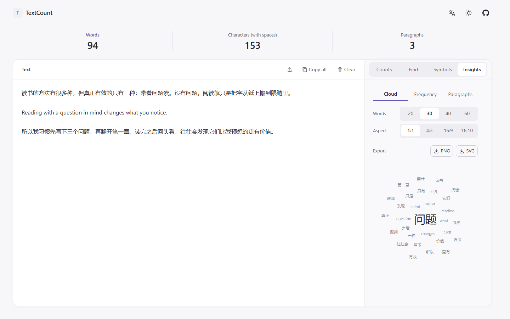

<div align="center">

# TextCount

**本地优先的中英混排文字统计工具。**

字数、词频、词云 —— 全部在浏览器里完成。

[**在线试用 →**](https://jett-wu.github.io/TextCount/) · [功能](#功能) · [开发](#开发)

[English](README.md) · **简体中文**

[](https://github.com/Jett-Wu/TextCount/actions/workflows/ci.yml)

</div>



## 为什么

大多数在线字数统计工具会上传你的文本、要求登录，或者在旁边挂广告。TextCount 是一个纯静态页面，
所有计算都在本地完成：没有账号、没有埋点，页面加载之后不再发起任何网络请求。

## 功能

- **中英混排计数**，口径与 Word 的「字数」一致 —— 汉字逐字计一，英文按词计一，标点不计入主数字。
- **查找、标点审查与分析** —— 段落分布、词频、词云，按需计算。
- **词云**可调整词数与比例（1:1 · 4:3 · 16:9 · 16:10），导出 SVG 或 3000 像素 PNG。
- **本地导入 PDF / DOCX / DOC**，只有在你选中文件时才下载解析器。
- **五种界面语言**，明暗主题，支持键盘与触屏。

## 隐私

文本只存在于浏览器内存中：不上传、不写入 `localStorage`、不放进 URL —— 刷新即清空。
只有偏好设置（主题、语言、计数规则）会被记住。

页面由 GitHub Pages 托管，它会保留常规访问日志；你的文本不会到达那里，到达的只是对静态文件的请求。

> [!NOTE]
> 「本地处理」不等于「可离线使用」—— 首次访问仍然需要网络来获取页面本身。

## 开发

```bash
npm ci
npm run dev        # 启动 Vite 开发服务器
npm run build      # 类型检查 + 构建到 dist/
npm run preview    # 本地预览构建产物
```

Node 24。构建产物发布在 `/TextCount/` 子路径下，与 GitHub Pages 的路径一致，所以
`npm run preview` 的地址是 <http://127.0.0.1:4173/TextCount/>。这个路径很关键：Vite 会给每个
资源 URL 加上它，一旦名称或大小写不匹配，部署后整个包都会 404。

### 几条设计说明

- `src/core/` 存放全部计数规则，不依赖 DOM、框架与 Node，因此同一份代码可以在主线程、Worker 与测试中运行。
- 计数从不截断或抽样。后台 Worker 不可用时，扫描回退到主线程并明确提示，而不是静默降级。
- 一百万字符：约 3 ms 同步计算，无超过 50 ms 的长任务，按键延迟约 3.5 ms。首屏体积 39 kB（gzip）。

## 许可证

MIT —— 见 [LICENSE](LICENSE)。
